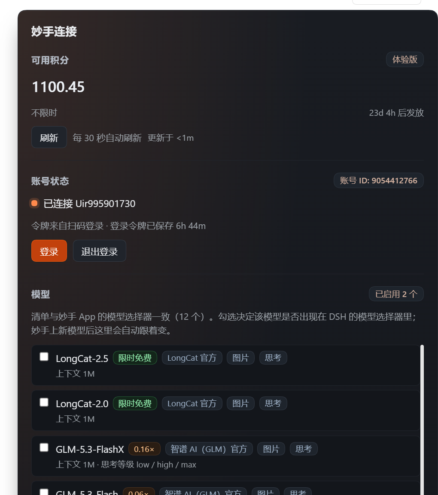

# dsh-connect-miaoshou

Wire the **Miaoshou (Meituan CatPaw / catpaw-moon)** desktop client already signed in on this
machine into **DeepSeek Harness**.

It reuses Miaoshou's own passport session (by default it reads `~/.meituan-catpaw/auth.json`,
or you can sign in once by QR code from the settings card and not depend on the client at all),
walks the `nocode.cn` chat → agent-stream → SSE chain, and translates the remote headless agent's
output into an OpenAI-compatible streaming response. A read-only card reports credits, plan and
the model roster.



## What it provides

- **Model provider `miaoshou`** — **12 models, aligned one-to-one with the Miaoshou app's model
  picker** (Auto / LongCat-2.5 / LongCat-2.0 / GLM-5.3-FlashX / GLM-5.3-Flash / GLM-5.3 /
  DeepSeek-V4.1-Flash / DeepSeek-V4-Pro / MiniMax-M3.1-Flash / MiniMax-M3 / Kimi-K3.1-Pro /
  Kimi-K3). Display names match the app; call names follow each vendor's casing rules.
  All 12 were verified live.
- **Settings card "妙手"** — available credits, plan expiry and next grant countdown, account
  status, per-model checkboxes (which decide what shows up in the harness model picker), upstream
  URL override, and diagnostics (catalog size and source, credential state).
- **Credits panel** — read-only, showing what is **left** rather than what is used, with each
  model's credit-cost multiplier.

## Known limits

- **Text only.** Miaoshou's image path goes through the `images` field of `create`; that leg is not
  wired, so every model declares `text` modality only — the picker will not let you attach an
  image, rather than letting you attach one the model cannot see.
- **8–12 s to first token.** The upstream emits the whole paragraph at once (not incremental), and
  the plugin cannot change that. It looks like "wait, then everything appears".
- **Usage is always 0.** Miaoshou bills in credits and returns no token usage; each turn's credit
  cost is carried in the custom `miaoshou.creditCost` field of the OpenAI response.
- **Models may carry an agent opener.** The upstream injects a "this is a knowledge question…"
  style preamble into some requests; `isAgent:false` does not fully remove it.
- **The passport has no refresh token** (`capabilities.canRefresh === false`), so an expired
  session has to be re-scanned.

## What it does not do

- It does not execute Miaoshou's remote tools (that is the remote headless agent's business), so
  `isAgent` is pinned to `false` and what comes back is plain text.
- Sign-in is optional: with the client already signed in its token is reused; without the client
  you can scan a QR code once in the card.
- The browser side never touches the token: every route returns a numeric view only.

## Credential sources

Three sources, in priority order.

### 1. QR sign-in (recommended; no dependency on the desktop client)

In the settings card, "账号状态" → "扫码登录" → open the link → scan and confirm in a browser.
The token is written to disk. It is Miaoshou's own passport token (152 characters), byte-identical
to `auth.accessToken` in the client's `auth.json`, and all four auth headers accept it.

### 2. The client's session file (fallback)

```
~/.meituan-catpaw/auth.json   →   auth.accessToken
```

`MIAOSHOU_HOME` points at a different directory. The token is the raw value, no `Bearer` prefix.

### 3. The `ep` CLI — enterprise accounts only

`ep` belongs to Meituan's **merchant** account system and is not the same as a CatPaw account.
The code path is kept for enterprise `EnterpriseEpAccountService`, but it is not the main route.

The two chains use **two different** auth header sets; mixing them returns 401:

| Purpose | Host | Headers |
| --- | --- | --- |
| Chat (create / agent-stream / SSE) | `nocode.cn` | `access-token` + `client-id: catdesk`; SSE also `X-Passport-Token` + `Cookie` |
| Credits, account | `catx.nocode.cn` | `X-Auth-Token` |
| Model catalog + multipliers | `catpaw-agent.meituan.com` | `X-Passport-Token` |

## Thinking levels

A harness thinking level is translated into `modelParams.declarativeParams` at the top level of the
agent-stream body. Only levels the upstream really accepts appear in the picker:

| Harness level | Sent upstream |
| --- | --- |
| Off | `{"thinking":"false"}` |
| Low / Medium / High / Xhigh / Max | `{"thinking":"true","effort":"<same level>"}` |
| Model has no `thinking` param (GLM trio, MiniMax-M3.1-Flash) | send `effort` only |
| Model has no `effort` param (LongCat-2.0/2.5, MiniMax-M3) | `High` means "thinking on" → `{"thinking":"true"}` |

The upstream enum-validates `effort` (an illegal value yields an empty response for the whole
turn), so unsupported levels are simply not exposed. `Auto` takes no parameters and only offers Off.

## Development

```bash
npm run build      # tsdown: lib/index.js (ESM) + lib/client.js (CJS)
npm run typecheck  # tsc, both tsconfigs
npm run check      # typecheck + build
```

`lib/client.js` **must be CJS**: the host does not add `type="module"` to a plugin's client entry;
ESM fails with `Cannot use import statement outside a module` and the whole web entry stops
activating.

## Install

```bash
dsh plugin install <absolute path to this directory>
```

or, once published:

```bash
dsh plugin --profile web add dsh-connect-miaoshou
```

## License

MIT © 2026 Wahwayhale
